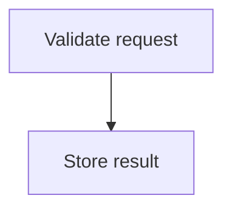

# Inline Mermaid renderer

Snacks invokes the `bin/mmdc` adapter through Neovim's own `PATH`. It renders
Mermaid source with Pele, resolves its SVG theme variables, and rasterizes with
resvg. It implements the input, output, theme, background, and scale flags used
by Snacks. It does not launch Chromium.

Install dependencies after setting up these dotfiles (Node.js 20 or newer):

```sh
cd ~/.dotfiles
stow -t ~ home nvim
cd ~/.config/nvim/tools/mermaid
npm ci
```

Restart Neovim after installation. Normal shells continue to use the original
Mermaid CLI. Pele has its own layout and styling, so diagrams can look different
from Mermaid.js. Renderer errors appear through Snacks notifications.

Ordinary boxes and groups use 12px corners. The adapter converts Pele's CSS
corner radius into an SVG attribute for resvg; special diagram shapes keep
their own geometry.

Colors come from `~/.local/share/mermaid-theme`, shared with the Claude browser
preview. Explicit `style`, `classDef`, and `linkStyle` colors win. Semantic
classes such as `success`, `warning`, `danger`, `active`, `changed`, `removed`,
and `muted` select a color from the light or dark palette:



Without a class, only clear state labels such as `Queued`, `Running`, `Completed`,
and `Failed` infer a color. Questions, negated outcomes, and component descriptions
such as `No errors`, `Not ready`, and `Error handler` stay neutral. Apply the
`neutral` class to disable inference for a node. Change and removal colors always
require an explicit class. Edges with clear outcome labels share the color with
their arrowhead and label. No AI call runs during rendering.

Run the shared classifier and real rasterizer checks from the dotfiles directory:

```sh
node --test home/.local/share/mermaid-theme/tone.test.mjs nvim/.config/nvim/tools/mermaid/theme.test.mjs
```

`<leader>vmt` / `:MarkdownReadingMode` still toggles persistent Markdown and
diagram rendering.

The bundled monochrome Noto Emoji font provides emoji glyphs that resvg cannot
read from Apple's color font. It comes from Google Fonts' `ofl/notoemoji`
directory and is licensed under the SIL Open Font License in `fonts/OFL.txt`.

After changing the adapter or upgrading its dependencies, clear
`~/.cache/nvim/snacks/image/pele` before restarting so Snacks regenerates PNGs.

To return to the original renderer, remove the adapter `PATH` setup and Pele
cache setting from `lua/plugins/markdown-render.lua`, then restart Neovim.
